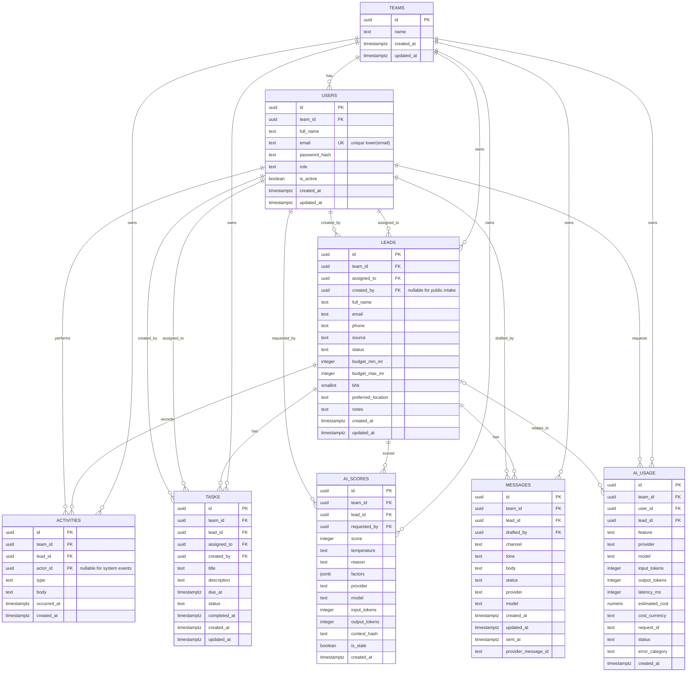

# UrbanNest CRM database ER model

**Status:** SQLAlchemy ORM implemented; review before applying a migration to the hosted database.  
**Database:** PostgreSQL  
**Tenant model:** one team per user; every business record is team-scoped.

## Relationships and integrity rules

- Every user belongs to exactly one team in this assessment. The email address is globally unique for simple login lookup.
- Every lead belongs to a team. Its optional creator and optional assignee, when present, must belong to that same team. Public form leads may have no authenticated creator.
- Activity, task, score and message rows carry `team_id`; composite foreign keys to `(id, team_id)` on users/leads ensure these rows cannot reference a lead or user from a different team. System-generated activities may have no human actor.
- AI usage belongs to a team and requesting user; `lead_id` is optional for non-lead-specific AI operations.
- `tasks.assigned_to` is required: every reminder must have a clear owner. Assign a task when it is created; do not create an unassigned task.
- Define unique constraints on `(id, team_id)` for `users` and `leads` to support the composite references.
- Normalize user emails with trimming and lowercase before persistence, enforce canonical lowercase with a database check, and enforce uniqueness through a functional unique index on `lower(email)`.
- Foreign keys from child rows should generally use `RESTRICT`/`NO ACTION`; use explicit deletion/retention workflows rather than cascading away sales history.
- Store timestamps as timezone-aware UTC. Convert to `Asia/Kolkata` only for user-facing date and due-today calculations.
- Budgets are integer INR amounts (rupees), not floating-point values.

## Controlled values and checks

- User role: `owner`, `manager`, `agent`.
- Lead stage: `new`, `contacted`, `site_visit`, `negotiation`, `won`, `lost`.
- Lead source: `website`, `99acres`, `magicbricks`, `instagram`, `whatsapp`, `walk_in`, `manual`, `csv_import`, `other`.
- Activity type: `call`, `note`, `site_visit`, `status_change`, `assignment_change`, `email`, `whatsapp`, `other`; actor may be null for system/public events.
- Task status: `open`, `completed`, `cancelled`; overdue is derived from `due_at` and open status, not stored.
- Score temperature: `hot`, `warm`, `cold`; score range is 0–100.
- Message channel: `whatsapp`, `email`; status: `draft`, `approved`, `sent`, `delivered`, `failed`. `sent` means provider accepted the send request; only `delivered` means delivery confirmation was received. Populate `sent_at` and provider message ID when integration supplies them.
- AI usage status: `succeeded`, `failed`, `timed_out`.
- `estimated_cost` is paired with an uppercase ISO 4217 `cost_currency`; no currency is assumed if the provider does not supply cost. `request_id` is an optional application request correlation ID.
- Check nonnegative budgets and token/latency counts; require `budget_min_inr <= budget_max_inr` when both are present; require BHK to be positive when supplied; require score within 0–100.

## Indexes

- `leads(team_id, status)`, `leads(team_id, assigned_to, status)`, `leads(team_id, created_at)`.
- `activities(team_id, lead_id, occurred_at DESC)`.
- `tasks(team_id, assigned_to, status, due_at)` and `tasks(team_id, lead_id, due_at)`.
- `ai_scores(team_id, lead_id, created_at DESC)`; query latest non-stale score.
- `messages(team_id, lead_id, created_at DESC)`.
- `ai_usage(team_id, created_at DESC)`, `ai_usage(team_id, feature, created_at DESC)`, `ai_usage(request_id)`.

## Decisions held for implementation

1. Use SQLAlchemy 2.x declarative mappings and Alembic migrations.
2. Keep enums/checks as database constraints and matching Python enums so invalid persisted states are rejected.
3. Use UUID primary keys and application-generated UUID values.
4. Scores are append-only history. Relevant lead/activity changes mark prior scores stale; the UI must not display stale score as current.
5. AI usage stores operational metadata only. Do not persist prompts, completions, API keys, or unnecessary personal data in this table.
6. Task assignee is required; public lead creator and activity actor are nullable to represent unauthenticated/system-originated records.
7. This ER model does not itself create tables. Review the ORM and generated migration before applying it to the hosted database.
