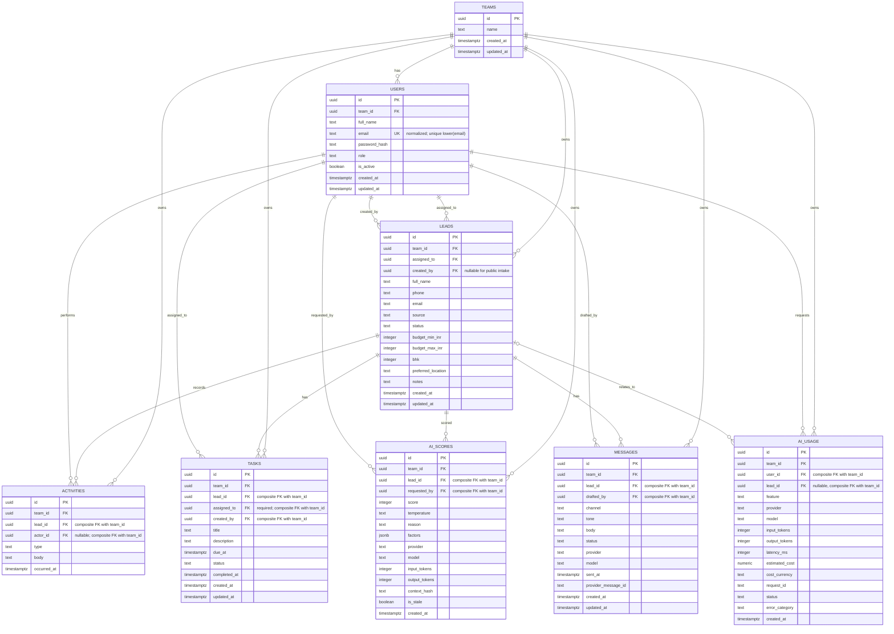

# Infinaut CRM: AI Sales Copilot — 2-hour plan

**Status:** kickoff proposal; confirm open decisions with the Infinaut team  
**Project:** UrbanNest Realty, Pune  
**Team:** Candidate 1 — backend, database, and AI (you); Candidate 2 — frontend (`[Teammate]`)  
**Target:** deployed CRM with seeded demo data within the 48-hour assessment

## 1. Goal and scope

Build a mobile-friendly CRM that brings leads from the agency's sources into one pipeline, makes follow-ups visible, and uses AI to help agents prioritize and communicate. The backend is a FastAPI service backed by managed PostgreSQL. The frontend is a separate, production-minded client owned by Candidate 2: responsive UX, appropriate SEO for public pages, client-side caching, and real-estate-specific workflows are part of the frontend scope, not optional polish.

The first implementation priority is authentication and server-enforced data visibility. AI features must use the same authorization boundary as normal API requests; a model must never receive records the requesting user is not allowed to see.

### Must ship

- Owner, manager, and agent roles, enforced by the API.
- Manual, CSV, and public-form lead capture.
- Lead pipeline: `new`, `contacted`, `site_visit`, `negotiation`, `won`, `lost`.
- Lead details and activity timeline.
- Follow-up tasks with due-today and overdue views.
- AI lead score, follow-up message draft, and notes-to-structured-data extraction.
- Seeded demo data: at least 50 leads and 3 agents; demo login for each role.

### Stretch, only after must-ship flows work

- Restricted, tool-based AI sales assistant and weekly AI report.
- Duplicate detection, next-best-action suggestions, and multilingual drafts.

## 2. Ownership and collaboration

| Workstream | Owner | Deliverable / handoff |
|---|---|---|
| FastAPI service, configuration, API conventions, deployment wiring | Candidate 1 (you) | Running API, OpenAPI docs, `.env.example`, health endpoint |
| Managed PostgreSQL schema, migrations, seed data, indexes | Candidate 1 (you) | ER model below, reproducible migrations, 50+ fake leads |
| Authentication, role authorization, and record-level scoping | Candidate 1 (you) | Login/current-user APIs and tests proving each role's visibility |
| Lead, activity, task, and CSV/public-capture APIs | Candidate 1 (you) | Versioned endpoint contract below |
| Frontend product, UI/UX, responsive implementation, SEO, client-side cache and integration UX | Candidate 2 (`[Teammate]`) | Complete agent-ready application, public lead-capture page, cache/invalidation behavior, and real-estate workflow integrations below |
| Shared API contract and integration | Both | Agree request/response shapes early; integrate against `/docs` or a shared API collection |
| AI scoring, drafting, extraction, then restricted assistant/report | Candidate 1 (you) | Add only after auth and data scoping are in place |
| Pull requests, review, demo preparation | Both | Separate branches/PRs; each candidate reviews the other's work and can explain the shared flows |

Use a shared GitHub repository. Agree on the endpoint payloads before parallel UI/API implementation. Candidate 2 should use fake/mock responses only until the corresponding endpoint is ready; Candidate 1 should keep the OpenAPI contract current. Keep credentials and real client data out of Git.

### Frontend product scope (Candidate 2)

- **Responsive, usable CRM:** design and implement the full login, dashboard, lead pipeline, lead detail/activity timeline, task/reminder, lead-capture/import, and AI-result flows. Support narrow mobile screens as well as desktop; prioritize clear status, next action, readable forms, keyboard/focus behavior, loading/empty/error states, and confirmation for consequential actions. The goal is a usable sales-agent workflow, not just a visual shell.
- **SEO where it applies:** make the public-facing landing/lead-capture page discoverable and fast with meaningful page titles/descriptions, semantic headings and form labels, mobile layout, and social sharing metadata as appropriate. Authenticated CRM screens contain private client data and should be excluded from indexing (for example, `noindex`); SEO does not mean exposing the CRM or lead data to search engines.
- **Client-side data cache:** use the frontend framework's established query/cache approach (proposed: TanStack Query if compatible with the selected framework). Cache server state with sensible stale/refetch behavior for leads, pipeline, tasks, and dashboard summaries; use loading and stale-data indicators where helpful. Keep cache keys scoped to the authenticated user/team and clear user-specific cached data on logout or account change.
- **Cache invalidation and freshness:** after lead create/update/status change, activity/task changes, CSV import, or AI score/extraction updates, invalidate or update all affected lead, pipeline, task, and dashboard queries. Do not let optimistic updates mask API failures; roll back or refetch and show an actionable error. Revalidate on navigation/focus when appropriate. The backend remains the source of truth and still enforces authorization on every request.
- **Real-estate-specific experience and integrations:** represent property intent clearly (budget, BHK, preferred Pune locality, source, pipeline stage, site-visit date/notes, and follow-up). Make lead source visible and preserve attribution for website, property portals, Instagram, WhatsApp, and walk-ins. Provide CSV import and a mobile-friendly public inquiry form. Where a direct provider API or credentials are unavailable, treat portal/social/WhatsApp sources as attribution plus manual/CSV capture, not as a claimed live integration. A WhatsApp draft may offer a user-initiated `wa.me` handoff after review; never claim it was sent without a sending integration.
- **Integration handoff:** agree API payloads and error/loading states with Candidate 1 early. The frontend may hide actions for convenience but must never treat UI role checks as authorization. AI extraction proposals should be reviewable and editable before the user confirms a database change.

## 3. Proposed architecture

```text
Browser / frontend (Candidate 2)
        | HTTPS, JSON, Bearer access token
        v
FastAPI (Candidate 1) ── authentication + role/record authorization
        |                          |
        | SQLAlchemy                | authorized, minimal context only
        v                          v
Managed PostgreSQL             AI provider
        ^
        | migrations / seed script
Alembic
```

- **API:** FastAPI, Pydantic request/response models, `/api/v1` prefix, generated OpenAPI at `/docs`.
- **Database:** managed PostgreSQL, accessed through SQLAlchemy; schema changes via Alembic migrations. Keep the provider configurable until the team confirms its free-tier and deployment fit (for example, Neon or Supabase PostgreSQL).
- **Deployment:** assessment target is Vercel. Confirm FastAPI runtime and managed database connectivity during kickoff; keep the service stateless and configuration-driven. If the chosen hosting setup cannot run the API reliably, agree on an alternate API host with the assessment team rather than silently changing the requirement.
- **Auth:** email/password with hashed passwords and signed bearer access tokens. The authenticated user and current role are loaded/validated server-side; token claims alone are not sufficient for data access.
- **Configuration:** environment variables for database URL, token secret, frontend origin, and AI provider credentials. Keep secrets server-side; commit `.env.example`, never `.env`.
- **Safety:** validate input and output with Pydantic, use parameterized ORM queries, paginate list endpoints, and return a consistent error response. Configure CORS to the actual frontend origin.

## 4. Authorization and data boundary

All authenticated business records belong to a `team_id`. The user identity comes from the verified token and the database, not from a client-supplied user ID, role, or team ID.

| Role | Allowed records |
|---|---|
| Agent | Leads assigned to that agent within their team; activities and tasks for those leads |
| Manager | Team leads and team activities/tasks; can review team agents and performance |
| Owner | All records for their team; team-level reports and settings |
| Public visitor | Only the public lead-capture operation; no CRM read access |

Apply the team and role/assignment filter in backend service/database queries for every read, update, export, and AI operation. A guessed record ID must not bypass the filter. Reject unauthorized access without revealing whether another team's record exists. Test both list and direct-ID access for every role.

For AI, first fetch only records visible to the requesting user, then pass the minimum relevant fields to the model. The assistant may call narrowly defined backend functions (for example, `list_hot_leads_without_recent_follow_up`); it must not execute model-generated SQL or accept arbitrary team/user filters from the model. Validate AI output, handle timeout/provider errors explicitly, and record usage without logging secrets or unnecessary lead PII.

## 5. Initial data model

The model uses a team as the tenant boundary. A team has users, leads, and tasks; a lead has activities, tasks, score history, and message drafts. The canonical ERD with constraints and indexes is [docs/ERD.md](./ERD.md); the diagram below is the planning summary.



**Schema notes**

- `role` is one of `owner`, `manager`, `agent`; `status` is one of the pipeline states listed above. Enforce allowed values in application validation and, where practical, database constraints.
- A lead is always scoped to one team. Validate that assignees and non-null creators belong to that same team. Public form leads may have no authenticated creator.
- `activities` is the timeline for calls, notes, site visits, status/assignment changes, and other events. Store structured event type plus human-readable details; actor may be null for system/public events.
- `tasks.assigned_to` is required so every follow-up has an owner; task creation must assign a user in the same team.
- `ai_scores` is append-only score history; the latest non-stale score is the current score. Mark the prior score stale after relevant lead/activity changes so an old score is never presented as current; re-score on demand or through an explicitly implemented workflow.
- `messages` stores editable drafts and their channel/tone; `sent` means a provider accepted a send request, while `delivered` requires provider delivery confirmation. Do not mark messages sent without an actual integration.
- Normalize user emails by trimming and lowercasing; enforce the canonical form with a database check and case-insensitive uniqueness with a unique index on `lower(email)`.
- `ai_usage` stores operational usage metadata (feature, provider/model, token counts, latency, outcome, optional request ID and cost with uppercase ISO currency), not raw prompts or unnecessary lead PII. Keep access restricted; it supports later usage analysis without exposing secrets.
- Store budget consistently as integer INR amounts (for example, rupees), and document the chosen convention in API schemas.
- Add indexes for team/status, team/assignee/status, lead/activity time, and assignee/task due date. Use unique email and pagination for list queries.
- Add indexes for AI usage time/feature/request ID and score lead/time as needed; keep usage metadata restricted and avoid storing prompt text by default.

## 6. API contract (initial)

All JSON business routes use `/api/v1`. Authenticated requests send `Authorization: Bearer <access_token>`. Responses use Pydantic schemas; timestamps are ISO 8601 UTC. List responses are paginated (`items`, `limit`, `offset`, `total`).

| Method and path | Purpose | Access |
|---|---|---|
| `POST /api/v1/auth/login` | Verify credentials and return access token/user summary | Public |
| `GET /api/v1/auth/me` | Return current user and role | Authenticated |
| `GET /api/v1/leads` | Filter/search/paginate visible leads; filters may include status, assignee, source | Role-scoped |
| `POST /api/v1/leads` | Create a lead; validate requested assignee is in the caller's team | Authenticated; role rules |
| `GET /api/v1/leads/{lead_id}` | Lead details with latest score and timeline summary | Role-scoped |
| `PATCH /api/v1/leads/{lead_id}` | Update editable lead fields or pipeline status | Role-scoped; manager/owner may reassign |
| `GET /api/v1/leads/{lead_id}/activities` | Paginated timeline | Role-scoped |
| `POST /api/v1/leads/{lead_id}/activities` | Record call, note, visit, or other activity | Role-scoped |
| `GET /api/v1/tasks?due=today\|overdue` | Get visible due-today or overdue tasks | Role-scoped |
| `POST /api/v1/tasks` | Create a follow-up task for a visible lead | Role-scoped |
| `PATCH /api/v1/tasks/{task_id}` | Update task or mark complete | Role-scoped |
| `POST /api/v1/leads/import` | Upload CSV; return row-level created/rejected summary | Authenticated; manager/owner |
| `POST /api/v1/public/leads` | Accept a website-form lead; validate and rate-limit | Public; creates within configured team |
| `POST /api/v1/leads/{lead_id}/ai/score` | Score a visible lead and persist structured result | Role-scoped |
| `POST /api/v1/leads/{lead_id}/ai/draft` | Draft editable email/WhatsApp follow-up using authorized timeline | Role-scoped |
| `POST /api/v1/leads/{lead_id}/ai/extract` | Parse notes into proposed fields/task; user confirms before saving | Role-scoped |
| `POST /api/v1/assistant/chat` | Ask a scoped question using allowlisted query functions | Authenticated; only after core authorization |
| `GET /api/v1/reports/weekly` | Weekly team summary and AI narrative from real aggregates | Manager/owner; stretch |
| `GET /health` | Liveness check without secrets or database details | Public |

The frontend should treat the API as the source of truth for role visibility and pipeline/task updates. The public lead endpoint must not expose CRM records. CSV imports should report validation errors per row and must not silently discard failures.

## 7. Build order and checkpoints

| Time / phase | Candidate 1 — backend, database, AI | Candidate 2 — frontend | Exit check |
|---|---|---|---|
| Kickoff to +2h | Confirm provider/deployment constraints; agree schema, API payloads, ownership and branches; publish this plan | Confirm full CRM journeys, responsive breakpoints, public SEO scope, cache strategy/invalidation map, and real-estate source/workflow requirements | Both candidates agree on owners and interface |
| +2h to +12h (core first) | FastAPI setup; managed Postgres connection; migrations; demo users; login; role and record scoping; leads CRUD/status; health/deploy | Build login and responsive role-aware shell; connect dashboard/pipeline and lead detail to agreed contract; establish cache keys and mutation invalidation for core lead flow | Deployed rough auth, schema and pipeline; role boundary tests pass; key CRM flow works on mobile and desktop |
| +12h surprise request | Assess impact together; update task split/schema/API as required; avoid destabilizing authorization | Adjust UX/API integration plan together | Surprise requirement is documented and split |
| After auth + data scoping | Implement A1 scoring, A2 message drafting, A3 notes extraction with validation and confirmation; then stretch assistant/report if time | Integrate AI controls and review/confirmation UX; complete tasks, forms/import, and relevant cache updates | AI context and results respect the same record visibility rules |
| Remaining time to +48h | CSV/public capture, tasks, seed data, tests, deploy fixes, README and usage/limitations notes | Finish responsive UX, public-page SEO/private-route noindex, cache invalidation and error-state checks, niche workflows, test/demo polish, demo video | Submission checklist is ready; each candidate can explain shared flows |

**Dependency:** AI chat and any AI feature that assembles multi-record context starts only after authentication and data scoping are implemented and tested. A1–A3 remain required assessment features; the assistant and weekly report are lower priority.

## 8. Step-by-step delivery roadmap

The hour ranges are planning estimates, not promises. Work can proceed in parallel when the API contract is agreed, but each gate below must pass before dependent work is treated as complete. If time gets tight, defer optional quality features and stretch features before cutting authorization, required A1–A3, or end-to-end verification.

| Step | Target window | Owner(s) | Work | Fulfillment conditions (definition of done) |
|---|---|---|---|---|
| 1. Kickoff decisions and contract | 0–2h | Both | Confirm hosting, compare managed Postgres free-plan/connection limits, frontend framework, timezone, AI provider, role rules, branch/PR workflow; agree endpoint payloads and primary user journeys. Freeze the initial auth, lead, task, AI and error response shapes. Deploy a minimal FastAPI health/database probe and verify a frontend-to-API call. | This plan is reviewed; owners are assigned; unresolved decisions have an owner; hosting, CORS and database connectivity are proven early; frontend can start against agreed request/response shapes; no real client data or credentials are in the repo. |
| 2. Backend and frontend foundations | 2–4h | Candidate 1: API/config; Candidate 2: app shell/design system | Set up FastAPI configuration, health route, environment example, bounded SQLAlchemy connection pool, database connection/migration baseline, frontend routing, responsive shell, API client and query/cache conventions. | API starts locally and exposes `/docs` and `/health`; frontend starts locally and reaches the agreed API base URL; pool capacity is calculated across workers/instances and fits the provider's limit; missing configuration fails with a clear error; `.env` is ignored and `.env.example` contains placeholders only. |
| 3. Schema, migrations and demo identity | 3–6h | Candidate 1 | Implement teams, users, leads, activities, tasks, AI score, message, and AI usage tables; constraints/indexes; migration and initial fictional team/role users. | A clean managed/local database can be created from migrations; all required tables and foreign keys exist; seed command is repeatable or safely detects existing seed data; seeded owner, manager and agent can be identified for testing. |
| 4. Authentication and authorization gate | 4–8h | Candidate 1; Candidate 2 integrates login | Implement login/current-user and backend role/record filters. Add explicit tests for agent, manager and owner. | Correct credentials authenticate; incorrect credentials are rejected; unauthenticated business API access is rejected; Agent A cannot list, fetch, update, or use an AI endpoint on Agent B's lead; manager and owner see only the permitted scope. Do not start multi-record AI context work until these tests pass. |
| 5. Lead pipeline end to end | 6–12h | Candidate 1: API; Candidate 2: responsive UI | Implement lead create/list/detail/update, status transitions, search/filter/pagination, activity timeline, and connect frontend pipeline/detail screens. | A user can create a fake lead, see it in the correct role-scoped list, change its stage, open details, and see an activity; invalid status and out-of-scope IDs are rejected; core flow works at mobile and desktop widths; successful mutations refresh affected cached views. |
| 6. First deployed checkpoint | By +12h | Both | Deploy rough but functioning auth, schema and pipeline; add essential demo data and verify deployment configuration. | Shared live URL loads; demo owner/manager/agent can log in; deployed lead pipeline works end to end; role-boundary checks pass against the deployed API; blockers and the next work split are recorded. |
| 7. Tasks, lead capture and intake | 12–20h | Candidate 1: endpoints/validation; Candidate 2: task/forms/import UX | Add follow-up tasks and due/overdue filtering, activities, CSV import, and public lead form/API. | Tasks can be created, completed, and assigned within authorization rules; due-today/overdue use the agreed timezone; CSV returns row-level success/errors; public intake creates a lead but cannot read CRM data; frontend invalidates task, lead and dashboard caches after changes. |
| 8. Required AI features A1–A3 | 16–30h, after Step 4 | Candidate 1: AI service/API; Candidate 2: review/edit UX | Add a provider-independent AI interface, structured lead scoring, personalized draft generation, and notes extraction with validation and human confirmation. Use direct provider calls for simple tasks; add LangGraph only if a workflow genuinely needs multi-step control flow. | A1 returns validated 0–100 score, temperature and reason and persists a score record; relevant lead/activity changes mark prior scores stale; A2 uses only authorized lead/timeline context and returns an editable unsent draft; A3 proposes validated fields/task without saving until confirmed; provider timeout/failure is visible and does not corrupt CRM data; usage metadata is recorded without logging secrets or unnecessary PII. |
| 9. Product polish and frontend quality | 20–36h, in parallel | Candidate 2 leads; both integrate | Finish responsive role-aware CRM workflows, loading/empty/error states, keyboard/focus behavior, public-page metadata, private-route noindex, cache scoping/invalidation, and real-estate-specific lead/property UX. | Public page has useful title/description and semantic form labels; authenticated routes are not indexed; logout/account change clears user-scoped cache; each relevant mutation refreshes affected views; lead source, budget, BHK, locality and site-visit context are usable in the UI; unsupported provider integrations are not presented as live. |
| 10. Optional stretch features | Only after Steps 1–9 are on track | Both, scoped by remaining time | Consider restricted AI assistant, weekly report, duplicate detection, next-best-action, or multilingual message draft. | Feature has an explicit scope, role boundary, user-facing error path and test; assistant uses allowlisted query functions and never executes model-generated SQL. Skip if it threatens any required acceptance check. |
| 11. Submission hardening and handoff | 36–48h | Both | Run clean-start/migration/seed checks, role regression tests, frontend integration smoke tests, deployment smoke tests; complete README, demo logins, limitations/AI usage notes, demo video and submission links. | Submission checklist in the assessment is complete; 50+ fictional leads and 3+ agents are seeded; demo credentials work; no secret is committed; both candidates can explain the architecture, their own work, and the shared authorization/AI flow. |

### Change-control rule for the +12h surprise request

When the surprise request arrives, spend a short, agreed time clarifying its user story and acceptance condition. Both candidates identify affected API/schema/UI work, estimate it, and decide what lower-priority item to defer. Record the decision in the shared issue/PR; do not weaken role scoping or silently break the agreed API contract.

## 9. Optional quality features (out of required scope)

These are deliberately not prerequisites for a functional assessment submission. Pick at most one or two only after the required CRM, A1–A3, deployment, and submission docs are complete. Each item needs a clear owner and acceptance check before implementation.

| Optional feature | Why it improves quality | Suggested fulfillment check |
|---|---|---|
| Audit trail for sensitive changes | Helps owners understand reassignment, status changes, and administrative actions | Changes record actor, entity, action and timestamp; audit records are role-scoped and not editable through normal CRM APIs. |
| Duplicate-lead warning | Prevents agents following up on the same inquiry twice | On create/import, suggest possible matches using normalized phone/email; user reviews the match and can explicitly proceed; no automatic destructive merge. |
| Idempotency for public lead capture/import | Reduces duplicate records when clients retry requests | Repeating a request with the same idempotency key returns the original result rather than creating duplicate leads. |
| Accessibility pass | Makes the CRM more usable for a wider range of agents | Keyboard can reach and operate core pipeline/form flows; focus is visible; form errors are associated with fields; color is not the only status cue; contrast is checked. |
| Performance and observability basics | Makes slow or failing requests easier to diagnose | API logs include request ID, route, status and duration without tokens/PII; dashboard and lead list avoid unbounded queries; list endpoints have enforced pagination. |
| Better mobile pipeline interaction | Improves practical use during property visits | Pipeline remains operable on a narrow viewport using an intentional layout (for example, horizontally scrollable columns or a stage-filtered list); stage changes have a touch-friendly alternative to drag-and-drop. |
| AI evaluation examples | Makes prompt changes less likely to regress useful outputs | A small fictional test set checks score schema, extraction field validity, and message tone; failed or malformed model output is handled without saving invalid data. |
| Privacy and retention controls | Reduces unnecessary retention of sensitive lead data | Document what lead data is sent to the AI provider, provide a deletion path for demo records, and avoid sending contact details when not needed for the task. |
| Localization-ready UI | Supports a future Pune audience without duplicating screens | User-facing strings and date/currency formatting are centralized; INR and `Asia/Kolkata` display conventions are consistent. |

## 10. Acceptance checks for the first deployed milestone

- Owner, manager, and agent demo accounts can authenticate.
- Agent A cannot list, fetch by guessed ID, update, or ask AI about Agent B's lead.
- Manager can see team records but cannot access another team if tenancy is added.
- Owner can see all records in their team.
- Pipeline status accepts only the defined states.
- A relevant lead or activity change marks its previous AI score stale rather than presenting it as current.
- A task due today and an overdue task appear in the correct views using a single documented timezone policy.
- Core pipeline, lead detail, and task workflows remain usable on a phone and desktop; loading, empty, and error states are handled.
- Mutating a lead, activity, task, or AI result refreshes the affected cached views; logout/account change clears user-specific cache.
- Public pages have appropriate metadata; authenticated CRM pages are not indexed and do not render private data for crawlers.
- Lead source and property-intent fields support the agreed real-estate workflow; integrations are described accurately as live, manual, or CSV-based.
- Migrations and seed data run from a clean database; seed data is fictional.
- API docs are reachable in the deployed environment without exposing secrets.

## 11. Decisions to confirm at kickoff

1. Which managed PostgreSQL provider (compare current Aiven, Neon and Supabase free-tier limits) and API hosting arrangement fit the Vercel requirement? Verify quota, connection limits, inactivity/expiry policy and runtime compatibility rather than assuming plan details.
2. Is the assessment a single UrbanNest team, or should the first schema support multiple client teams? This plan uses `team_id` scoping either way.
3. What frontend origin, login/demo credentials, and token lifetime should be used?
4. Which AI provider/model and available credits should be used? Keep the provider swappable by server-side configuration; decide whether LangGraph adds enough value for any multi-step workflow.
5. What timezone should drive due-today/overdue calculations? Default proposal: `Asia/Kolkata`, stored timestamps in UTC.
6. Who is Candidate 2, and what frontend framework/API client are they using?
