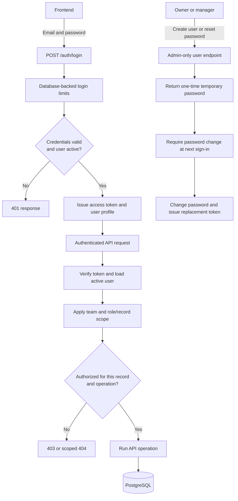
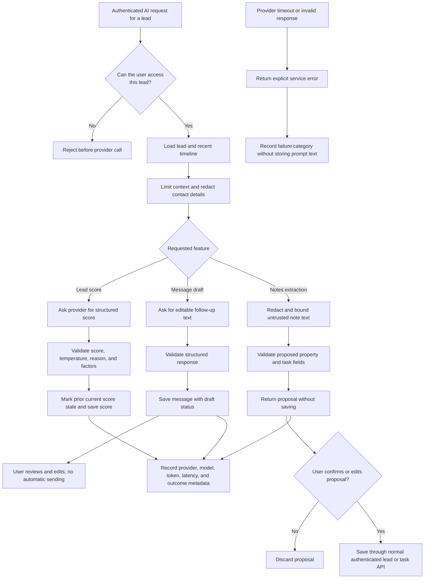

# CRM workflow diagrams

These diagrams describe the implemented API boundaries and data flows. The
frontend may not expose every documented API feature yet; AI routes are
available through the backend API.

## Sign-in, access checks, and account recovery



The browser's role is only for presenting the appropriate controls. The API
loads identity and access from the database for protected requests; a client
supplied team ID or role never grants access.

## Lead intake, pipeline, follow-ups, and shared activity

```mermaid
flowchart TD
    Website[Website form] --> Public[POST /public/leads]
    Public --> PublicChecks[Validate fields, configuration, and shared rate limit]
    PublicChecks --> PublicLead[Create unassigned website lead]
    PublicLead --> PublicActivity[Add website inquiry timeline activity]
    PublicLead --> PublicAudit[Write contact-free team audit event]

    Manual[Authenticated user] --> CreateLead[POST /leads]
    CreateLead --> ManualLead[Validate and create lead in caller's team]
    ManualLead --> ManualAudit[Write lead audit event]

    CSV[Owner or manager CSV upload] --> Import[POST /leads/import]
    Import --> RowCheck[Validate file, rows, and same-team assignees]
    RowCheck --> Imported[Save valid rows and return row errors]
    Imported --> ImportAudit[Write team import audit event]

    Lead[Visible lead] --> Update[Update stage or assignment]
    Update --> History[Write timeline activity]
    Update --> Stale[Mark existing AI scores stale when relevant]
    Update --> ChangeAudit[Write safe audit change fields]
    History --> LeadCommit[Commit lead update]
    Stale --> LeadCommit
    ChangeAudit --> LeadCommit
    PublicActivity --> IntakeCommit[Commit public intake]
    PublicAudit --> IntakeCommit
    ManualAudit --> ManualCommit[Commit manual lead]
    ImportAudit --> ImportCommit[Commit CSV import]

    Lead --> FollowUp[Create follow-up task]
    FollowUp --> TaskChecks[Check lead visibility and active same-team assignee]
    TaskChecks --> OpenTask[Store open task and audit event]
    OpenTask --> TaskCommit[Commit task change]
    TaskCommit --> DueViews[Dashboard and task lists show open, due-today, overdue]
    DueViews --> Complete[PATCH /tasks/{task_id}: completed]
    Complete --> CompleteAudit[Write task update audit event]
    CompleteAudit --> CompleteCommit[Commit completion]
    CompleteCommit --> CompletedView[GET /tasks?status=completed]
    LeadCommit --> Notify[Publish committed audit event]
    IntakeCommit --> Notify
    ManualCommit --> Notify
    ImportCommit --> Notify
    TaskCommit --> Notify
    CompleteCommit --> Notify
    Notify --> Feed[Role-filtered shared activity feed]
    Feed --> Cursor[Each user has an independent read cursor]
```

Lead visibility is enforced on list and detail requests: agents see leads
assigned to them; managers and owners see their team's leads. Task access is
also checked against the related lead and task assignee. Audit events are
stored once per team and filtered for each viewer; read state is per user.

## AI-assisted lead workflows



AI output is treated as untrusted data: it is schema-validated and never used
as SQL or as a substitute for authorization. Short AI calls run inline with
explicit errors; they are not durable background jobs.
